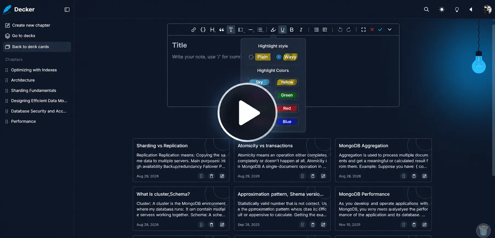

# Decker

Decker is a note-taking application that helps you organize information into decks, cards, and chapters. It provides a structured way to create, manage, and organize notes with rich-text editing and drag-and-drop reordering. As an installable Progressive Web App (PWA), Decker also supports offline reading of previously available notes, while creating, editing, and deleting notes requires an internet connection.

## **Demo**

Click the thumbnail below to watch the Decker demo on YouTube.

## Features

### Note Organization

- **Decks, Cards & Chapters:** Organize notes using a hierarchical structure.
- **Create & Manage Notes:** Create, edit, and delete decks, cards, and chapters.
- **Drag-and-Drop Reordering:** Reorder decks, cards, and chapters using drag-and-drop interactions.
- **Pinned Decks:** Pin important decks for quick access.

### Rich Text Editor

- **Rich Text Editing:** Format notes using a rich-text editor powered by Slate.js.
- **Slash Commands:** Access editor actions through a slash-command palette.
- **Structured Content:** Create and maintain well-organized notes.

### Progressive Web App

- **Installable:** Install Decker on supported devices for an app-like experience.
- **Offline Access:** Read previously cached notes while offline.

## Tech Stack

- **Frontend:** React 18, TypeScript, Vite, Tailwind CSS
- **Backend:** Node.js, Express.js, TypeScript
- **Database:** MongoDB with Mongoose
- **Authentication:** Passport.js, Google OAuth 2.0, Local Authentication
- **Rich Text Editor:** Slate.js
- **Drag and Drop:** dnd-kit
- **Data Fetching & Caching:** TanStack Query (React Query)
- **Routing:** React Router
- **Virtualization:** react-window
- **Animations:** Motion
- **Progressive Web App:** vite-plugin-pwa

_Decker — a simple, structured way to organize your notes._
